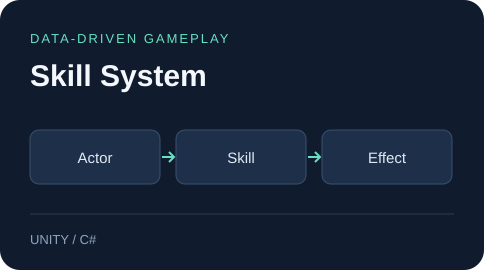
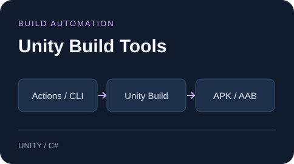

  <b>게임플레이와 게임 시스템을 구현하는 클라이언트 개발자입니다.</b> 
  Unity / C# · TypeScript / Phaser · 모바일 게임 · 멀티플레이

  
  

## Featured Projects

### Pawblossom Puzzle · 매치3 퍼즐

동물 친구들의 부탁을 해결하며 숲속 마을을 가꾸는 **매치3 퍼즐 게임**입니다.

- **구현:** 8×8 보드, 연쇄 제거·낙하, 특수블록·조합, 힌트·보드 재배치
- **콘텐츠:** 10개 스테이지, 별·코인 보상과 화단 꾸미기, 영어·한국어, 로컬 저장
- **기술:** TypeScript · Phaser · Capacitor Android

**현재:** 플레이 가능한 v0.1.0 시제품. Android 실기기 검증·튜토리얼·광고·결제는 다음 단계이며, 한국·해외 Google Play 출시를 목표로 개발합니다.

[프로젝트 →](https://github.com/ChoiDaeYoung-94/Pawblossom-Puzzle) · [보드 엔진 ↗](https://github.com/ChoiDaeYoung-94/Pawblossom-Puzzle/blob/main/src/core/BoardEngine.ts) · [개발 로드맵 ↗](https://github.com/ChoiDaeYoung-94/Pawblossom-Puzzle/blob/main/docs/roadmap.ko.md)

### Sudden Force FPS · 멀티플레이 FPS

방을 만들고 팀을 선택해 DesertHouse에서 한 판을 진행하는 **Unity 3D FPS**입니다.

- **전투:** 호스트 권한의 사격·부위별 피해 판정, 반동·재장전, 사망·리스폰
- **경기:** 팀 점수·타이머·KD·킬 피드·스코어보드, 결과 화면과 로비 복귀
- **기술:** Unity 6 · C# · Photon Fusion 2 · Android

**현재:** 개발을 재개해 PC·Android 경기 검증을 진행하고, Google Play 내부 테스트에 출시했습니다. Play에서 설치한 앱의 로그인·경기와 남은 기기 호환성 검증을 진행 중입니다.

[프로젝트 →](https://github.com/ChoiDaeYoung-94/sudden-force-fps) · [전투 코드 ↗](https://github.com/ChoiDaeYoung-94/sudden-force-fps/blob/main/Assets/Scripts/Creature/Player/GamePlayerNetworkData.cs) · [멀티플레이 검증 ↗](https://github.com/ChoiDaeYoung-94/sudden-force-fps/blob/main/MULTIPLAYER_TEST_PLAN.md) · [Android·배포 기록 ↗](https://github.com/ChoiDaeYoung-94/sudden-force-fps/blob/main/ANDROID_RELEASE_CHECKLIST.md)

### Monster Tamer · 몬스터 수집 액션

<table>
<tr>
<td width="27%" align="center">

</td>
<td width="73%">

몬스터를 동료로 모아 함께 전투하는 <b>Android 3D 게임</b>

이동·전투·포획·동료·버프 시스템 PlayFab 연동 · Google Mobile Ads · Unity IAP

<a href="https://github.com/ChoiDaeYoung-94/Tamer">프로젝트 →</a> · <a href="https://github.com/user-attachments/assets/243e5193-5e8f-4966-8b98-c724b62767dd">기존 플레이 영상 ↗</a> · <a href="https://github.com/ChoiDaeYoung-94/Tamer/tree/main/Assets/Scripts/Creatures">핵심 코드 ↗</a>

</td>
</tr>
</table>

**현재:** Unity 6 / Android 환경에서 복구·검증 중입니다. 포획·동료 저장 등 게임플레이와 격리 앱의 구매·광고 흐름을 검증했으며, 가입 UI·최종 출시 빌드·스토어 검증은 진행 중입니다. [최신 복구 기록 ↗](https://github.com/ChoiDaeYoung-94/Tamer/blob/main/docs/revival/recovery-execution-backlog.ko.md)

## Selected Work

<table>
<tr>
<td width="36%">

</td>
<td width="64%" valign="top">
<h3>데이터로 구성하는 스킬 시스템</h3>

블리츠크랭크 Q 스킬 재현. 액터·스킬·효과를 분리하고 CSV로 스킬 정보를 설정합니다.

<a href="https://github.com/ChoiDaeYoung-94/skill-system">프로젝트 →</a> · <a href="https://github.com/user-attachments/assets/7f3320d5-8082-458e-a63d-24321c552966">시연 영상 ↗</a> · <a href="https://github.com/ChoiDaeYoung-94/skill-system/blob/main/Assets/Scripts/Skill.cs">핵심 코드 ↗</a>

</td>
</tr>
</table>

## Development Tools

<table>
<tr>
<td width="50%">

</td>
<td width="50%" valign="top">
<h3>반복 작업을 줄이는 개발 도구</h3>

<a href="https://github.com/ChoiDaeYoung-94/unity-cicd"><b>unity-cicd</b></a> Python CLI · GitHub Actions · Unity 빌드 버전 관리

<a href="https://github.com/ChoiDaeYoung-94/project-base"><b>project-base</b></a> 공통 씬·스크립트·프리팹을 모은 프로젝트 시작 기반

자동화 저장소에는 종료된 App Center 배포 방식의 구현 기록이 포함되어 있습니다.
</td>
</tr>
</table>

**[Incremental](https://github.com/ChoiDaeYoung-94/incremental)** · 2D 방치형 게임 기반 — 오브젝트 풀링, 로그인·저장, 게임 UI · [플레이 영상 ↗](https://user-images.githubusercontent.com/66999597/215687283-d704df78-6818-46a8-8b24-f8daa84d277e.mp4)

## Tech Stack

프로젝트에 사용한 기술입니다. 상세 구현과 실행 환경은 각 저장소에서 확인하실 수 있습니다.
