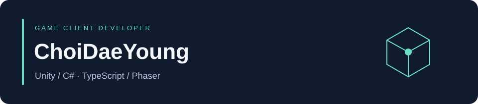
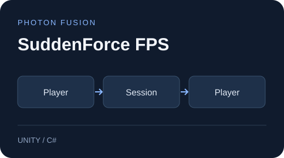

  <b>게임플레이와 게임 시스템을 구현하는 클라이언트 개발자입니다.</b> 
  Unity · C# · TypeScript · Phaser

  <a href="https://young-94.tistory.com/">기술 블로그</a> &nbsp; · &nbsp;
  <a href="https://github.com/ChoiDaeYoung-94?tab=repositories">전체 저장소</a>

## 진행 중인 게임

<table>
<tr>
<td width="25%" align="center">

</td>
<td width="75%" valign="top">
<h3>Pawblossom Puzzle</h3>

동물 친구들과 숲속 마을을 가꾸는 <b>매치3 퍼즐</b> 
연쇄·특수블록 · 10개 스테이지 · 영어·한국어 
TypeScript · Phaser · Capacitor

<b>시제품 완성</b> · Android 실기기 검증과 콘텐츠 보강 예정

<a href="https://github.com/ChoiDaeYoung-94/Pawblossom-Puzzle">저장소</a> · <a href="https://github.com/ChoiDaeYoung-94/Pawblossom-Puzzle/blob/main/src/core/BoardEngine.ts">보드 엔진</a> · <a href="https://github.com/ChoiDaeYoung-94/Pawblossom-Puzzle/blob/main/docs/roadmap.ko.md">개발 계획</a>

</td>
</tr>
<tr>
<td width="25%" align="center">

</td>
<td width="75%" valign="top">
<h3>Sudden Force FPS</h3>

로비에서 팀전 경기와 결과 복귀까지 이어지는 <b>멀티플레이 FPS</b> 
호스트 사격 판정 · 부위별 피해 · 리스폰 · 경기 HUD 
Unity 6 · C# · Photon Fusion 2

<b>내부 테스트 출시</b> · Play 설치본의 로그인·경기 검증 예정

<a href="https://github.com/ChoiDaeYoung-94/sudden-force-fps">저장소</a> · <a href="https://github.com/ChoiDaeYoung-94/sudden-force-fps/blob/main/Assets/Scripts/Creature/Player/GamePlayerNetworkData.cs">전투 코드</a> · <a href="https://github.com/ChoiDaeYoung-94/sudden-force-fps/blob/main/ANDROID_RELEASE_CHECKLIST.md">배포 기록</a>

</td>
</tr>
<tr>
<td width="25%" align="center">

</td>
<td width="75%" valign="top">
<h3>Monster Tamer</h3>

몬스터를 포획하고 동료로 모아 함께 싸우는 <b>3D 액션 게임</b> 
전투·동료·성장 · 계정·저장 · 광고·구매 연동 
Unity 6 · C# · PlayFab · Unity IAP

<b>복구·검증 중</b> · 가입 UI와 최종 출시 빌드 검증 진행

<a href="https://github.com/ChoiDaeYoung-94/Tamer">저장소</a> · <a href="https://github.com/user-attachments/assets/243e5193-5e8f-4966-8b98-c724b62767dd">기존 플레이 영상</a> · <a href="https://github.com/ChoiDaeYoung-94/Tamer/blob/main/docs/revival/recovery-execution-backlog.ko.md">복구 기록</a>

</td>
</tr>
</table>

프로젝트별 다음 단계

- **Pawblossom Puzzle:** 플레이 가능한 v0.1.0 시제품입니다. 튜토리얼·광고·결제와 실기기 검증을 거쳐 한국·해외 Google Play 출시를 목표로 합니다.
- **Sudden Force FPS:** PC·Android 경기 검증과 Google Play 내부 테스트 출시를 진행했습니다. Play 설치본 검증과 남은 기기 호환성 점검이 필요합니다. [멀티플레이 검증 기록](https://github.com/ChoiDaeYoung-94/sudden-force-fps/blob/main/MULTIPLAYER_TEST_PLAN.md)
- **Monster Tamer:** 포획·동료 저장과 격리 앱의 구매·광고 흐름을 검증했습니다. 운영 앱 전체와 최종 스토어 출시 검증은 진행 중입니다. [핵심 코드](https://github.com/ChoiDaeYoung-94/Tamer/tree/main/Assets/Scripts/Creatures)

## 시스템과 개발 도구

| 프로젝트 | 핵심 내용 | 살펴보기 |
| --- | --- | --- |
| [Skill System](https://github.com/ChoiDaeYoung-94/skill-system) | Actor·Skill·Effect 분리, CSV 기반 스킬 설정 | [핵심 코드](https://github.com/ChoiDaeYoung-94/skill-system/blob/main/Assets/Scripts/Skill.cs) · [시연 영상](https://github.com/user-attachments/assets/7f3320d5-8082-458e-a63d-24321c552966) |
| [Incremental](https://github.com/ChoiDaeYoung-94/incremental) | 2D 방치형 게임 기반, 풀링·로그인·저장·UI | [플레이 영상](https://user-images.githubusercontent.com/66999597/215687283-d704df78-6818-46a8-8b24-f8daa84d277e.mp4) |
| [unity-cicd](https://github.com/ChoiDaeYoung-94/unity-cicd) | Python CLI·GitHub Actions 기반 Unity 빌드 자동화 | 기존 App Center 배포 구현 기록 포함 |
| [project-base](https://github.com/ChoiDaeYoung-94/project-base) | 공통 씬·스크립트·프리팹을 모은 프로젝트 시작 기반 | 재사용 에셋 모음 |

## 사용 기술

| 분야 | 기술 |
| --- | --- |
| 게임 개발 | Unity · C# · Phaser · TypeScript |
| 모바일 | Android · Capacitor |
| 네트워크·서비스 | Photon Fusion · PlayFab · Unity IAP |
| 개발 자동화 | GitHub Actions · Python |

각 프로젝트의 구현 범위와 검증 결과는 해당 저장소에 기록합니다.
